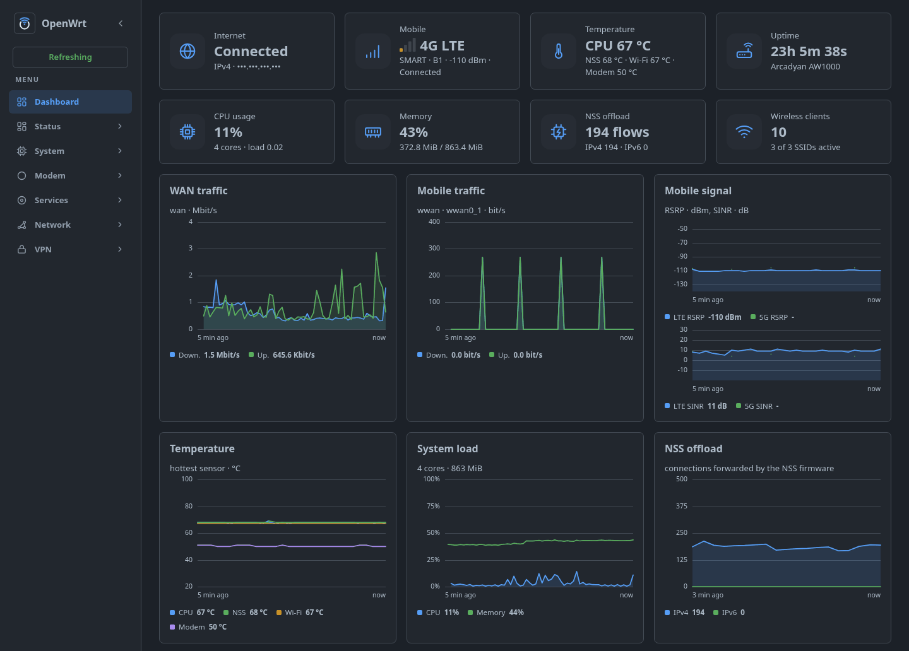
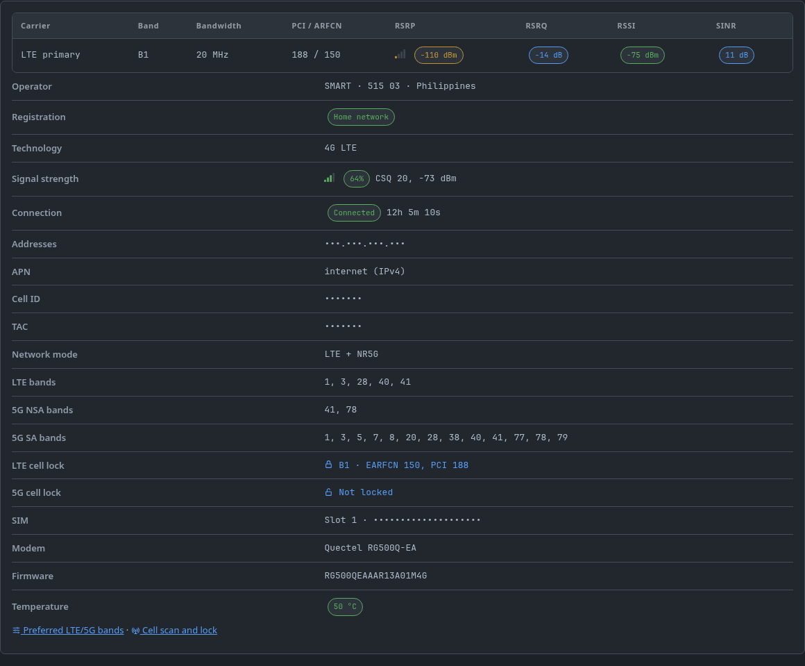
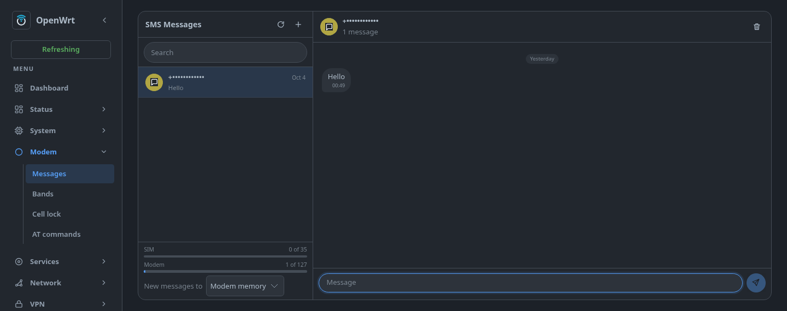
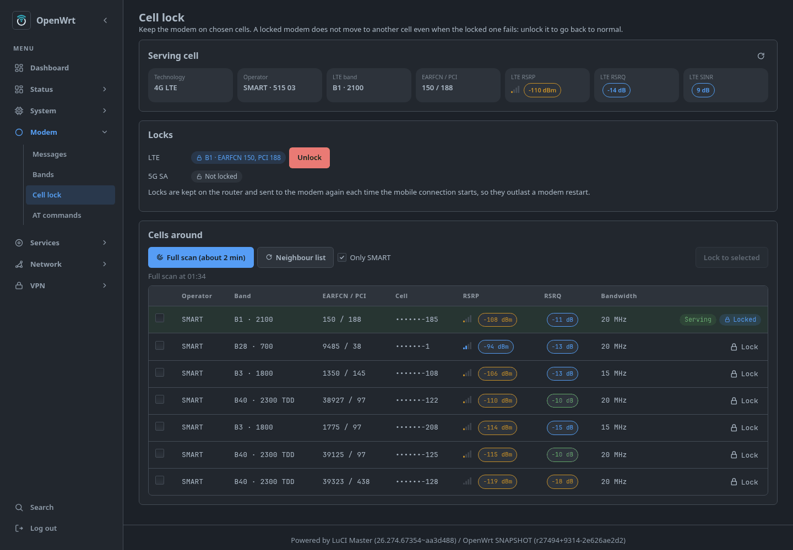
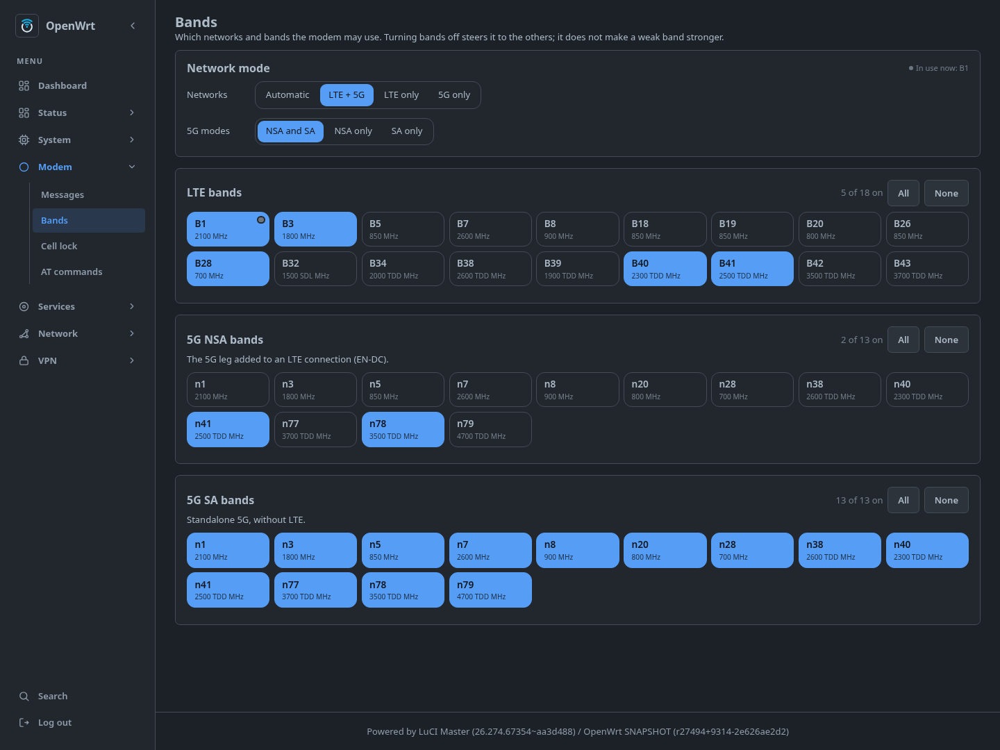
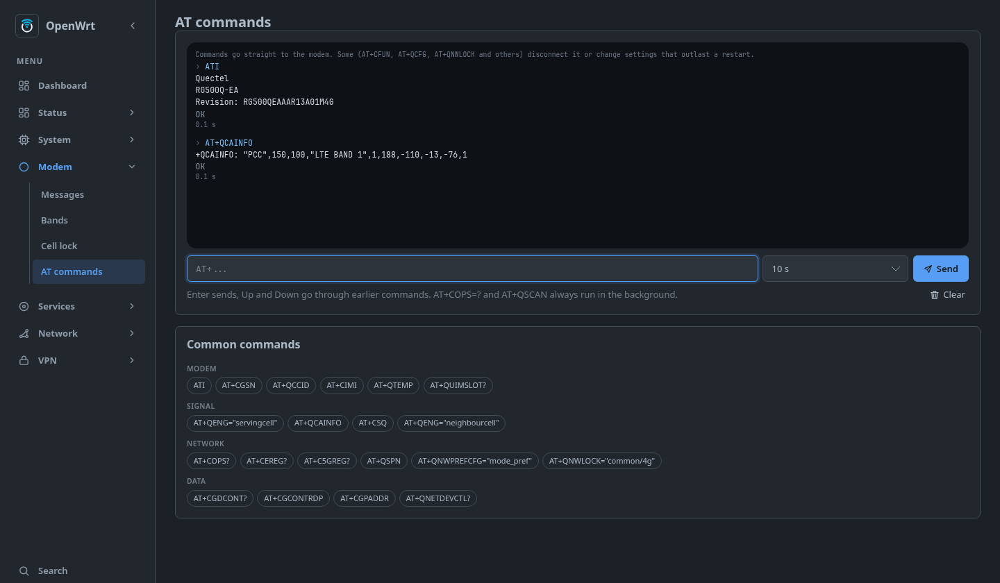
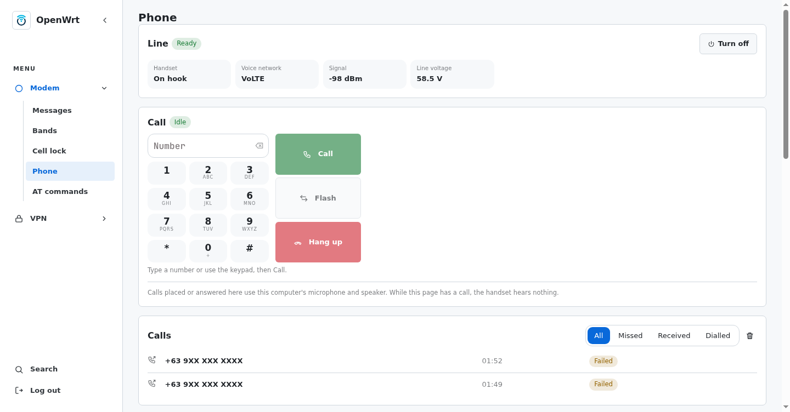
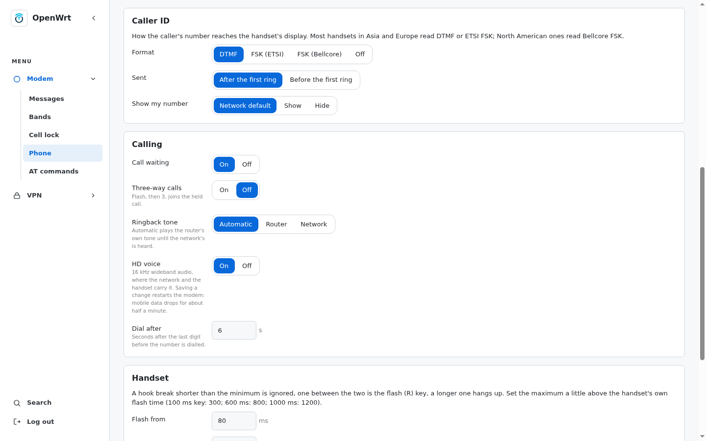

# aw1000-feed

OpenWrt package feed and build recipe for the **Arcadyan AW1000** on the
`ppe-nss` tree ([JuliusBairaktaris/openwrt-ppe-nss](https://github.com/JuliusBairaktaris/openwrt-ppe-nss), branch `ppe-nss`).

## Screenshots

Dashboard with the modem, temperature and NSS offload widgets:



| Mobile tab | SMS |
|---|---|
|  |  |
| **Cell lock** | **Bands** |
|  |  |



Modem → Phone: the RJ11 line, a dialler that makes and takes the SIM's calls
in the browser, the call log and the phone's settings:

| Phone | Phone settings |
|---|---|
|  |  |

Phone numbers, SIM and modem identifiers, addresses, cell IDs and the TAC
are masked.

## Packages

| Package | What it is |
|---|---|
| `kmod-qmi_wwan_q` | Quectel QMI WWAN driver 1.5.0 with QMAP multiplexing in raw-IP mode: each data call is its own `ARPHRD_RAWIP` netdev, `wwan0_1`..`wwan0_4` (`QMI_WWAN_Q_QMAP_MODE`, default 2 → `wwan0_1`, `wwan0_2`), one PDN each for `quectel-cm`. Modem traffic is offloaded by `nss-wifi-drv` on NSS core 0 (generic redirect nodes per raw-IP device, Julius's `ppe-nss` [PR #41](https://github.com/JuliusBairaktaris/openwrt-ppe-nss/pull/41)); see [docs/wwan-nss-offload.md](docs/wwan-nss-offload.md). |
| `quectel-cm` | quectel-cm 1.6.5 + netifd `quectel` proto: IPv4/IPv6 over separate QMAP channels (`option multiplexing 1`; the IPv6 call goes to modem profile 4, as 2 and 3 hold the VoLTE and emergency APNs), passthrough, NAT64 and a CLAT for an IPv6-only call ([docs/464xlat-offload.md](docs/464xlat-offload.md)), handover monitor. A watchdog power-cycles a modem that stops answering altogether (through the `lte_power` GPIO, with back-off; `option watchdog '0'` turns it off). Leaves the AT port the phone service holds alone. |
| `luci-proto-quectel` | LuCI form for the `quectel` proto. |
| `luci-app-aw1000-modem` | The Modem pages (below): SMS conversations, bands, cell scan and lock, the phone, AT console. Ships `aw1000-at`, which sends one AT command and waits as long as it needs. |
| `udp-broadcast-relay-redux` | Relays UDP broadcasts between networks (e.g. Tapo camera discovery on port 20002 across lan/iot). Removed from openwrt/packages in `90b98c14f` (upstream archived); vendored unchanged. |
| `aw1000-defaults` | First-boot settings: `wwan` interface (APN `internet`, IPv4), front-panel LEDs, USB drive automount (`/mnt/<device>`), Footstrap theme. Runs once (marker `system.@system[0].aw1000_defaults`). On every first boot, upgrades included: an 8 MB log ring (only over an unset or stock size), the NSS core's load reports on (`nss-wifi` param `load=1`, for the dashboard's NSS load line), the phone left off until switched on, and the [web front](#web-server) (nginx before uhttpd). Also ships `aw1000-leds`, `aw1000-modem-ports` and the dashboard widgets (below). |

From other feeds (`build/feeds`, pinned):

| Package | What it is |
|---|---|
| `kmod-awvoice-fxs`, `awvoice-phoned` | The RJ11 phone port, from [Pr0Luci/openwrt-aw1000-voice-awvoice](https://github.com/Pr0Luci/openwrt-aw1000-voice-awvoice) 1.1.4 (GPL-2.0): the board's line chip driver and the daemon that carries the SIM's calls (VoLTE) to an ordinary phone and to the browser. Its own LuCI app is left out; Modem → Phone is ours. Two build fixes in `build/patches/awvoice/`. |
| `kmod-amneziawg`, `amneziawg-tools`, `luci-proto-amneziawg` | AmneziaWG, from [2Grey/awg-openwrt](https://github.com/2Grey/awg-openwrt). Built as packages only, not in the image: a release ships the apks next to the images (`apk add --allow-untrusted ./*.apk`). The kmod fits that release's kernel only. |

`qmi_wwan_q` is Quectel's V1.5.0 as carried by FUjr/QModem `c49654e`
(builds on Linux 6.17+). `quectel-cm` and `luci-proto-quectel` are taken from
[xhikarishii/nss-packages](https://github.com/xhikarishii/nss-packages)
branch `aw1000-nss` at `ef05f5c` (GPL-2.0).

## Front panel

| LED | Meaning |
|---|---|
| signal (RGB) | LTE RSRP (the anchor on 5G NSA); steady green on 5G SA; off = no service |
| 5G (RGB) | NR RSRP on 5G SA or NSA; off on LTE only |
| internet | steady while fiber (`wan`) or the modem (`wwan`) can ping 1.1.1.1 / 8.8.8.8 |
| Wi-Fi | steady while the 5 GHz AP (`phy0-ap0`) is up |
| phone | blinks while there are messages not yet listed on Modem → Messages; while the phone service runs, it shows the line instead: solid when ready, blinking while it rings or the handset is off hook |

Quality colours: green ≥ −90 dBm, blue ≥ −105, red below.

Signal, 5G, internet and phone are driven by the `aw1000-leds` service, which
every 10 s polls `AT+QENG="servingcell"` and `+CPMS?` on the modem's second AT
port and pings out of each of `internet_ifaces` (`/etc/config/aw1000_leds`).

## Modem pages

LuCI's Modem menu is `luci-app-aw1000-modem`:

| Page | What |
|---|---|
| Messages | SMS as conversations: modem and SIM memory (a fill bar each), long messages put together, sent ones kept on the router (`/etc/aw1000-modem/sms-sent`); where new messages are stored (modem or SIM) |
| Bands | network mode, 5G NSA/SA, and the LTE / 5G NSA / 5G SA bands (`AT+QNWPREFCFG`), the ones in use marked |
| Cell lock | serving cell, LTE and 5G SA cell locks, neighbour list, full scan of every operator's cells (`AT+QSCAN`, about 100 s) |
| Phone | the RJ11 line (handset, VoLTE registration, signal, line voltage, on/off); a dialler with keypad, Answer / Reject / Hang up, Flash for call waiting and three-way calls; the call log with recordings and messages to play; caller ID format, call waiting, ringback, HD voice, flash timing and call recording |
| AT commands | console with history and common commands; slow ones run in the background |

The backend is the rpcd plugin `luci.aw1000-modem`. Settings are in
`/etc/config/aw1000_modem`: the cell locks, which the `quectel` proto sends
to the modem on every connect (they used to be its `cell_lock_4g` option),
the SMS country code (`0917…` is sent as `+63917…`: Smart's SMS centre
refuses national numbers) and the storage for new messages, which
`aw1000-leds` restores after a modem restart.

The Phone page drives `awvoice-phoned` over ubus. A call placed or answered
on the page uses the computer's microphone and speaker: the page opens the
microphone in the click, levels and resamples it in an AudioWorklet to the
line's 8 kHz, and streams 20 ms frames both ways over a WebSocket at
`/awvoice/audio` on the page's own address (see [Web server](#web-server)).
The page needs HTTPS and microphone access; the handset works without it.
While the phone runs it holds the modem's first AT port; the pages, the
proto and `aw1000-leds` move to the second (`aw1000-modem-ports port at`).
The phone is off in a fresh image: Modem → Phone → Turn on.

Every AT user takes the modem's lock, `/var/lock/aw1000-modem.lock`: all
ports lead to one command parser. The AT ports are chosen by USB interface,
not by `ttyUSB` number (`aw1000-modem-ports`): interface 2 for the pages,
interface 3 for `aw1000-leds`. A modem reset that renumbers the ports
(`ttyUSB3` → `ttyUSB4`) needs no manual fix.

## Dashboard widgets

`aw1000-defaults` adds widgets to `luci-mod-dashboard` (plain files in its
`view/dashboard/include/`, no patch):

| Widget | Card | Chart | Tab |
|---|---|---|---|
| `mobile` (`40_mobile.js`) | LTE / 5G NSA / 5G SA, operator, bands, RSRP, connected or standby | LTE and 5G RSRP and SINR, last 5 min | carriers (band, bandwidth, PCI, ARFCN, RSRP/RSRQ/SINR), cell ID, TAC, APN, addresses, band and cell locks (linked to the Bands and Cell lock pages), SIM, firmware, modem temperature |
| `mobile-traffic` (`40_mobile.js`) | | down/up over `wwan0_N` | |
| `thermal` (`45_thermal.js`) | CPU, NSS, Wi-Fi, modem °C | the same, last 5 min | |
| `nss` (`48_nss.js`) | hardware-offloaded connections: `/proc/net/nf_conntrack` (`[HW_OFFLOAD]`) + `/sys/kernel/debug/*.nss/flows` (`bridged`) via `aw1000-leds` | the same, last 5 min | |

The modem takes one AT command at a time, so the widgets never query it: `aw1000-leds` saves its replies and the temperatures to
`/tmp/aw1000-status/` every poll (`live`, `static` once a minute, `history`,
`thermal`, `nss`), and the widgets read those files (ACL
`luci-aw1000-dashboard`). Parsing and the signal icons are shared with the
modem pages in `aw1000/cell.js`; a reading's colour gives its quality (good,
fair, poor), named in its tooltip. A saved layout
(Dashboard → Layout) lists widgets by id; new ids only show once added
there.

The NSS core's own load (the UBI32 core that carries Wi-Fi, the modem and
464XLAT, invisible in the host's CPU usage) is a third line, NSS, in the
dashboard's System load chart, with a bar on its Resources tab. Our
`nss-wifi-drv` change ("report the core's load on request", in our OpenWrt tree) keeps the
firmware's load reports on with `load=1` and averages them in debugfs
(`/sys/kernel/debug/*.nss/load`) the way `qca-nss-drv`'s `cpu_load_ubi` did;
`build/patches/luci/0001-…-show-the-NSS-cores-load.patch` draws them.
`aw1000-defaults` turns the reports on (`nss-wifi.general.param 'load=1'`).

## Web server

nginx (`nginx-ssl`) listens on 80 and 443 and passes every request to uhttpd,
which still serves LuCI but only on `127.0.0.1:8080`. nginx adds one thing
uhttpd cannot do: it carries the Phone page's call audio, a WebSocket, to
`awvoice-phoned`'s listener on loopback (`awvoice.main.web_iface
'loopback'`), so the browser needs no second port or certificate exception.
`/etc/uci-defaults/96-aw1000-web` sets it up on every first boot, upgrades
included; nginx uses uhttpd's own certificate (converted to PEM in
`/etc/nginx/conf.d/_lan.*`), so a browser that trusted it keeps doing so.
OpenWrt's default `restrict_locally` filter is not used: as with uhttpd, the
firewall decides who reaches the router. The rules are in
`/etc/nginx/conf.d/aw1000.locations`. To go back to uhttpd alone: `uci set
nginx.global.aw1000_front=0`, restore uhttpd's `listen_http`/`listen_https`
and disable nginx. LuCI's log names `127.0.0.1` as the source of every login.

## Build

```sh
build/build.sh            # feeds, config, full build in a podman container
build/build.sh prepare    # feeds + .config only
build/build.sh release    # full build without ../private-files, checked for
                          # site data, images and extra apks to ../release/<name>/
build/build.sh shell      # shell in the build container
build/build.sh make menuconfig
```

Runs in `ghcr.io/openwrt/buildbot/buildworker-v3.11.8` as the invoking user;
only `../openwrt` is written. Expects `../openwrt`, `../nss-packages` and
`../builder-reference` next to this repo.

- `build/feeds` — feeds added to `feeds.conf.default`, in install order.
- `build/feeds.prefer` — packages taken from a given feed when several carry
  them (`sms-tool` from 4IceG's repo).
- `build/feeds.exclude` — installed feed packages removed again.
- `build/config` — appended to `builder-reference/devices/common/config`.
- `build/patches/<feed>/` — our patches applied to `feeds/<feed>`, after the
  builder's `patches/feeds/ppe-nss` (`awvoice`: kernel 6.16+ and GCC fixes;
  `luci`: the dashboard's NSS core load).
- `build/patches-openwrt/` — patches applied to the OpenWrt tree itself:
  `0001-aw1000-ramoops-match-nand-firmware.patch` and
  `0002-aw1000-disable-unused-nss1.patch`.
- `builder-reference/devices/common/files.ppe-nss/` — builder overlay
  applied after `devices/common/files` (first-boot `flow_offloading_hw=1`,
  `rc.local`).

## Licenses

Each package carries its own licence (`PKG_LICENSE`): `aw1000-defaults`,
`luci-app-aw1000-modem`, `kmod-qmi_wwan_q` and `quectel-cm` are GPL-2.0-only,
`luci-proto-quectel` and `udp-broadcast-relay-redux` are GPL-2.0. The Phone page's browser audio
(`webphone.js`, `webphone-worklet.js`) is ported from awvoice's LuCI app,
© 2026 Pr0Luci, GPL-2.0-only, and keeps its copyright lines.
